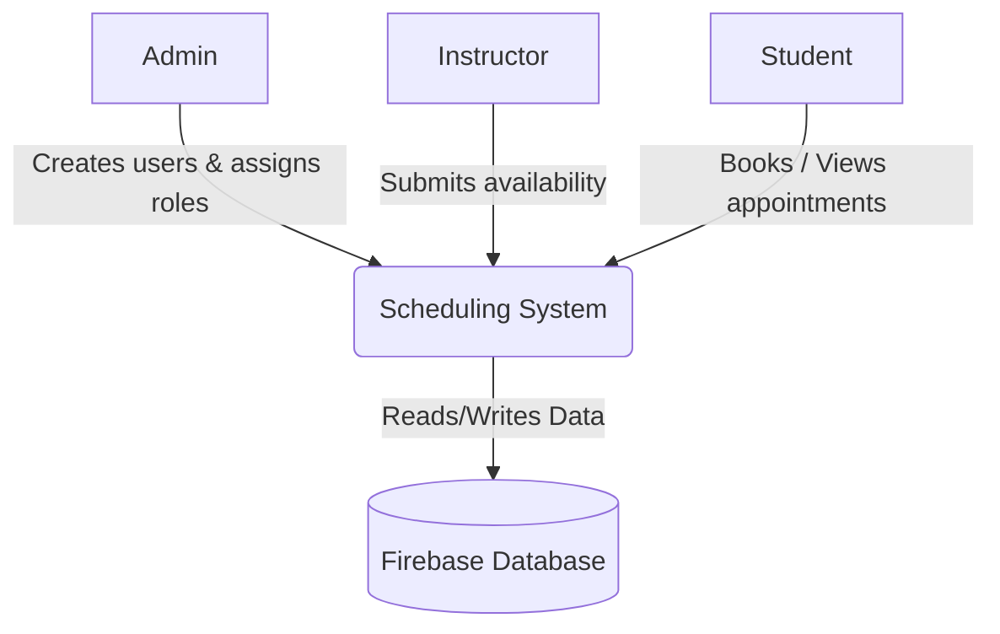

# SENG 321 - Appointment and Class Scheduling System

SENG 321 Term Project: A centralized appointment and class scheduling system with role-based access for administrators, instructors, and students.

## System Vision
To provide a scalable and reliable scheduling infrastructure that eliminates loss of time and operational communication overhead, centralizes private lesson scheduling processes by offering secure role management (Admin, Instructor, Student) and a seamless calendar experience in its initial release.

Details: [System Vision](docs/system-vision.md)

## System Boundary

In-scope and deferred features: [System Boundary](docs/system-boundary.md)

## Documentation

| Artifact | Link |
| :--- | :--- |
| Project Proposal | [docs/project-proposal.md](docs/project-proposal.md) |
| System Vision | [docs/system-vision.md](docs/system-vision.md) |
| System Boundary | [docs/system-boundary.md](docs/system-boundary.md) |
| Product Backlog | [docs/product-backlog.md](docs/product-backlog.md) |
| Combined Requirements | [REQUIREMENTS.md](REQUIREMENTS.md) |
| RACI Matrix | [docs/RACI_Matrix.md](docs/RACI_Matrix.md) |
| API Contract | [openapi.yaml](openapi.yaml) |
| API Integration Strategy | [docs/API_Integration_Strategy.md](docs/API_Integration_Strategy.md) |
| QA & Test Strategy | [docs/QA_Strategy.md](docs/QA_Strategy.md) |

## Team Roles
For the detailed responsibility distribution, see the [RACI Matrix](docs/RACI_Matrix.md).

* **Miraç Burak Esentürk** (@mburakesenturk) - Product Owner & Requirements Engineer
* **Eren Okat** (@erenokt3) - Lead Software Architect & Technical Lead
* **Furkan Çelebi** (@furkancelebi06) - Implementation & Integration Engineer
* **Ayşe Nida Yalçınkaya** (@anykaya06-cloud) - Scrum Master & Agile Process Coach
* **Merve Öksüz** (@MRVMerve) - QA & Test Automation Engineer
* **Şükrü Kağan Demir** (@kagandemir03) - DevOps & CI/CD Infrastructure Engineer

## Repository Workflow (Git-Flow)
* `main`: Contains assessed or released versions only (e.g., tagged sprint-1).
* `develop`: Integrates completed work intended for the next sprint release.
* `feature/*`: Short-lived branches for a single user story, technical task, or defect.

## Team Rules
* **Issue First:** Every change starts with a GitHub Issue, and the PR references it.
* **Pull Requests:** Direct pushes to main and develop are blocked.
* **Merge Requirements:** Every PR needs at least **1 peer review** and a **green CI check** (OpenAPI lint) before merging.

## License
This project is licensed under the [MIT License](LICENSE). The rationale is given in the [Project Proposal](docs/project-proposal.md).

## Sprint 1 Submission
* **Release Tag:** [sprint-1](https://github.com/SENG321-SchedulingSystem/Appointment-and-Class-Scheduling-System/releases/tag/sprint-1)
* **Pull Request:** [Sprint 1 Merged PRs](https://github.com/SENG321-SchedulingSystem/Appointment-and-Class-Scheduling-System/pulls?q=is%3Apr+is%3Amerged+base%3Amain)
* **Project Board (Issues):** [SENG 321 Project Board](https://github.com/orgs/SENG321-SchedulingSystem/projects/2)