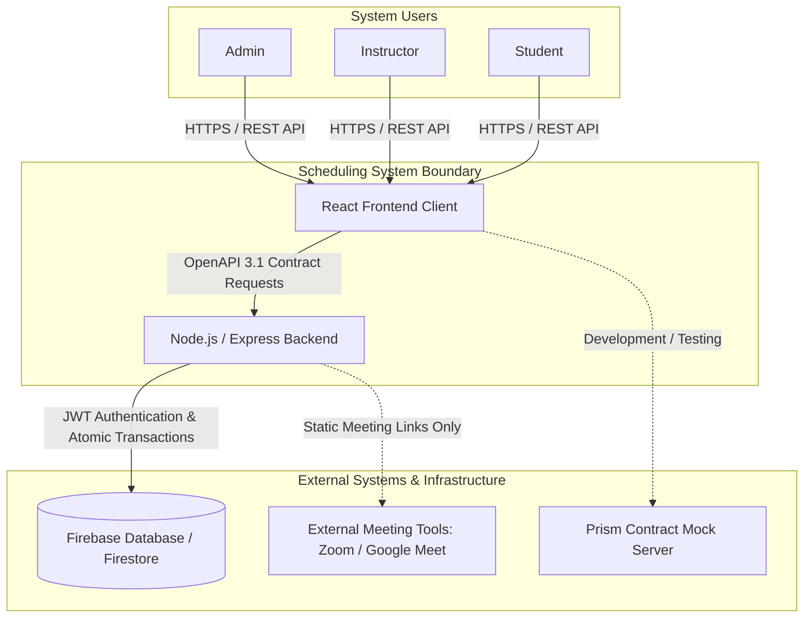

# Software Requirements & Foundation Specification
**Course:** SENG 321 – Software Engineering Project 1]  
**Project:** Appointment and Class Scheduling System  
**Current Milestone:** Sprint 1 Deliverables (Consolidated Specification)  

---

## 1. Project Proposal & Problem Definition

### 1.1 Project Title
Appointment and Class Scheduling System

### 1.2 Problem Statement & Supporting Evidence
Nowadays, instructors and students primarily coordinate private tutoring, office hours, and academic mentoring sessions via instant messaging platforms (WhatsApp, Telegram, etc.) and direct phone calls. Relying on unstructured communication channels introduces recurring operational failures:
- **High Operational Overhead & Lost Time:** Finding a mutually suitable time slot involves extensive back-and-forth messaging, causing unnecessary friction and delayed scheduling.
- **Double-Booking & Concurrency Conflicts:** Manually maintained calendars and paper agendas frequently lead to scheduling conflicts (double-bookings), especially when multiple students request the same slot simultaneously.
- **Lack of Authorization & Audit Trails:** Instructors often manage bookings without formal pairing or institutional oversight, leading to untracked cancellations, lost lesson history, and zero traceability.
- **Absence of Centralized Validation:** Manual booking processes fail to enforce core operational rules programmatically (e.g., preventing availability creation in the past or enforcing authorization boundaries).

### 1.3 Stakeholder Identification & Analysis
The proposed system directly engages three primary operational stakeholders and institutional supervisors:

| Stakeholder | Role / Description | Core Needs & Expectations | System Impact |
| :--- | :--- | :--- | :--- |
| **Admin** | System Operator & Coordinator | Centralized user provisioning, role assignments, and student-instructor pairing management. | Eliminates manual account handling and enforces verified academic pairings. |
| **Instructor** | Academic Tutor / Lecturer | Clear calendar visibility, intuitive availability slot declaration, and prevention of double-bookings. | Automates schedule sharing and guarantees zero past-dated or conflicting bookings. |
| **Student** | Learner / Mentee | Real-time visibility into assigned instructors' available hours and one-click conflict-free reservation. | Removes messaging delays and eliminates reservation uncertainty. |
| **Course Supervisors** | SENG 321 Instructors & Evaluators | Strict adherence to SE best practices (Git-Flow, C4, OpenAPI, CI/CD, traceability). | Transparent grading through versioned artifacts, contract testing, and clear role ownership. |

### 1.4 Proposed Solution & Expected Outcomes
The **Appointment and Class Scheduling System** provides a centralized, role-based platform built on an API-first architecture. The system automates the booking lifecycle through strict server-side validation and atomic concurrency controls.

- **Zero Double-Bookings (100% Conflict Prevention):** Utilizing atomic database transactions (Firebase transactions) to guarantee that simultaneous requests for the same slot strictly resolve with one success (`201 Created`) and subsequent conflicts (`409 Conflict`).
- **Rapid Booking Lifecycle:** Reducing the average appointment scheduling cycle from several hours of intermittent messaging down to under **15 seconds** of end-to-end user interaction.
- **Contract-Driven Consistency:** 100% adherence to the OpenAPI 3.1.0 specification (`openapi.yaml`), ensuring deterministic schema validation and decoupled frontend-backend workflows.
- **Strict Role Boundaries:** Enforcing JWT-based authorization where students only access assigned instructors and cannot alter slot structures or impersonate peers.

### 1.5 Feasibility Assessment
- **Technical Feasibility:** The tech stack comprises proven technologies: **React** for a responsive single-page frontend, **Node.js/Express** for API routing and business logic execution, and **Firebase** as a managed document database offering atomic transaction guarantees. Mock servers (Prism) and automated linters (Redocly) ensure seamless development before full backend integration.
- **Operational & Schedule Feasibility:** The project follows Agile/Scrum methodologies with defined sprints. The initial MVP scope (US-01 to US-05) covers strictly fundamental scheduling mechanics, deliberately deferring non-critical features (payments, video streaming) to ensure on-time delivery.
- **Resource Feasibility:** The team consists of six distinct engineering roles. Development utilizes free-tier and open-source tooling (GitHub Actions, Firebase Spark Plan, Jest, Prism), requiring zero infrastructure budget.

### 1.6 Assumptions & Potential Risks

| Category | Risk Description | Likelihood / Impact | Mitigation Strategy |
| :--- | :--- | :---: | :--- |
| **Concurrency** | Multiple students booking the exact same availability slot concurrently. | Medium / High | Implemented via database-level atomic transactions; server returns standard `409 SLOT_UNAVAILABLE` on race conditions. |
| **Authentication** | Unauthorized access or token tampering across role endpoints. | Low / High | Bearer JWT validation enforced globally on backend; student identity extracted directly from token claims rather than request payloads. |
| **Scope Creep** | Demands for real-time video conferencing, payment gateways, or multi-channel notifications. | High / Medium | Formalized System Boundary specification; out-of-scope items explicitly deferred to future release milestones. |
| **Integration** | Discrepancies between frontend expectations and backend implementations. | Medium / High | Strict API-First design; `openapi.yaml` acts as the single source of truth, verified by automated linting in CI. |

### 1.7 Open Source License Selection
This project is licensed under the **MIT License**. The MIT License is preferred because it is lightweight, flexible, and grants unrestricted rights to use, modify, and distribute the codebase without restrictive copyleft requirements.

---

## 2. System Vision Specification

### 2.1 Vision Statement
To provide a scalable, deterministic, and contract-driven scheduling infrastructure that eliminates operational communication overhead and appointment uncertainty. The system centralizes the private tutoring workflow by delivering strict role-based access control (Admin, Instructor, Student), automated calendar validations, and a zero-conflict reservation experience.

### 2.2 Target Users & Problem Context
- **Platform Administrators (Admins):** Operators requiring centralized governance over user credentials, institutional role assignments, and student-instructor academic pairings.
- **Academic Mentors & Tutors (Instructors):** Educators seeking an automated scheduling interface that prevents booking overlapping hours and rejects invalid past-dated availability.
- **Learners & Mentees (Students):** Students who require transparent, real-time calendar access to their assigned instructors without relying on erratic messaging threads.

### 2.3 System Responsibilities & Core Capabilities
- **Identity & Role Enforcement:** Authenticate users via JWT and enforce endpoint-level permissions based on system roles.
- **Pairing Governance:** Enforce academic access boundaries so students can only inspect availability and book lessons with explicitly assigned instructors.
- **Temporal Availability Validation:** Allow instructors to define future availability blocks while strictly validating against past dates and chronological errors.
- **Atomic Concurrency Control:** Manage simultaneous appointment reservations using database-level transaction locks, eliminating double-booking hazards.
- **Standardized Error Semantics:** Deliver predictable, RFC 7807-compliant problem details for all client and server exceptions.

---

## 3. System Boundary Specification

### 3.1 System Context & External Interactions
The scheduling system acts as a centralized application layer interacting with internal users and external infrastructure services.

- **Database Engine (Firebase / Firestore):** The backend interacts with Firebase for persistent document storage and relies on atomic transactions to prevent race conditions during booking. The frontend **never** connects directly to the database.
- **Contract Mocking Tooling (Prism):** During sprint development, the frontend consumes mock endpoints generated directly from `openapi.yaml` to ensure zero dependency on backend availability.
- **External Video Conferencing (Out of Boundary):** Live lesson environments (Zoom, Google Meet) operate strictly outside system boundaries; the platform only facilitates static link passing without active API integrations.

### 3.2 In-Scope Features (Sprint 1 / MVP)
- **User and Role Management:** Admin, Instructor, and Student role provisioning; duplicate registration checks (`409 Conflict`); student-instructor pairing management.
- **Calendar and Availability Management:** Forward-looking slot creation by instructors; strict chronological and past-date validation.
- **Appointment and Reservation Flow:** Filtered availability view for assigned instructors; conflict-free booking (`201 Created`); deterministic handling of race conditions (`409 Conflict`).

### 3.3 Out-of-Scope / Deferred Features
- Direct integrations with WhatsApp, Telegram, or SMS gateways.
- Payment processing, billing, and credit balance modules.
- Built-in video calling, screen sharing, or virtual whiteboard engines.
- File uploading, past lesson material storage, and homework assignment tracking.

### 3.4 Constraints & Assumptions
- **Architectural Constraint:** Strict API-first development conforming to `openapi.yaml` (v0.2.0).
- **Security Constraint:** Global Bearer JWT authentication required for all routes except `POST /auth/login`.
- **Temporal Constraint:** All timestamps must use standard ISO 8601 UTC format.
- **Assumptions:** Users maintain active internet connectivity; users are provisioned by Admin before entering operational flows.

---

## 4. Product Backlog & Engineering Traceability

### 4.1 Epics Overview
- **Epic 1: Identity, User Provisioning & Authorization (US-01, US-02)**
- **Epic 2: Availability & Atomic Appointment Engine (US-03, US-04, US-05)**

### 4.2 Backlog Matrix

| Priority | ID | Issue | Epic | User Story | Acceptance Criteria | Estimate (SP) | Dependencies | Assigned Owner |
| :---: | :---: | :---: | :--- | :--- | :--- | :---: | :--- | :--- |
| **1** | **US-01** | #19 | Epic 1: Identity & Provisioning | As an **Admin**, I want to add new instructors and students to the system so that I can manage authorized users. | • User account is successfully created with valid parameters. • Duplicate registrations with existing emails return `409 Conflict` (`EMAIL_ALREADY_EXISTS`). | **5** | None (Root Story) | Furkan Çelebi (@furkancelebi06) |
| **2** | **US-02** | #20 | Epic 1: Identity & Provisioning | As an **Admin**, I want to assign a student to a specific instructor so that I can establish authorization for taking lessons. | • The assignment relation is persisted in the database. • Attempts with invalid, nonexistent, or unauthorized user IDs return `404 Not Found`. | **3** | US-01 | Furkan Çelebi (@furkancelebi06) |
| **3** | **US-03** | #21 | Epic 2: Availability & Booking | As an **Instructor**, I want to add my available teaching hours to the system so that my students can book appointments with me. | • Forward-looking time slots are added successfully returning `201 Created`. • Slot entries for past dates or invalid chronological order return `400 Bad Request`. | **5** | US-01 | Eren Okat (@erenokt3) |
| **4** | **US-04** | #22 | Epic 2: Availability & Booking | As a **Student**, I want to view the available lesson hours of my assigned instructor so that I can plan an appointment for a suitable time. | • Returns an empty list or informational indicator if no slots exist. • Boundary date/time query parameters (`from`, `to`) filter records deterministically. | **3** | US-02, US-03 | Furkan Çelebi (@furkancelebi06) |
| **5** | **US-05** | #23 | Epic 2: Availability & Booking | As a **Student**, I want to book an appointment for an available slot of my instructor so that I can complete my lesson reservation. | • Successful reservation locks the slot and returns `201 Created`. • Race conditions or attempts on occupied slots return `409 Conflict` (`SLOT_UNAVAILABLE`) via atomic transactions. | **8** | US-02, US-03, US-04 | Eren Okat (@erenokt3) |

### 4.3 Engineering Traceability
- **OpenAPI Integration:** All functional requirements map directly to `openapi.yaml` endpoints (`POST /users`, `POST /assignments`, `POST /availability`, `GET /availability`, `POST /appointments`).
- **QA Strategy Alignment:** Every acceptance condition maps to concrete automated test cases and concurrency verification rules documented in `docs/QA_Strategy.md`.