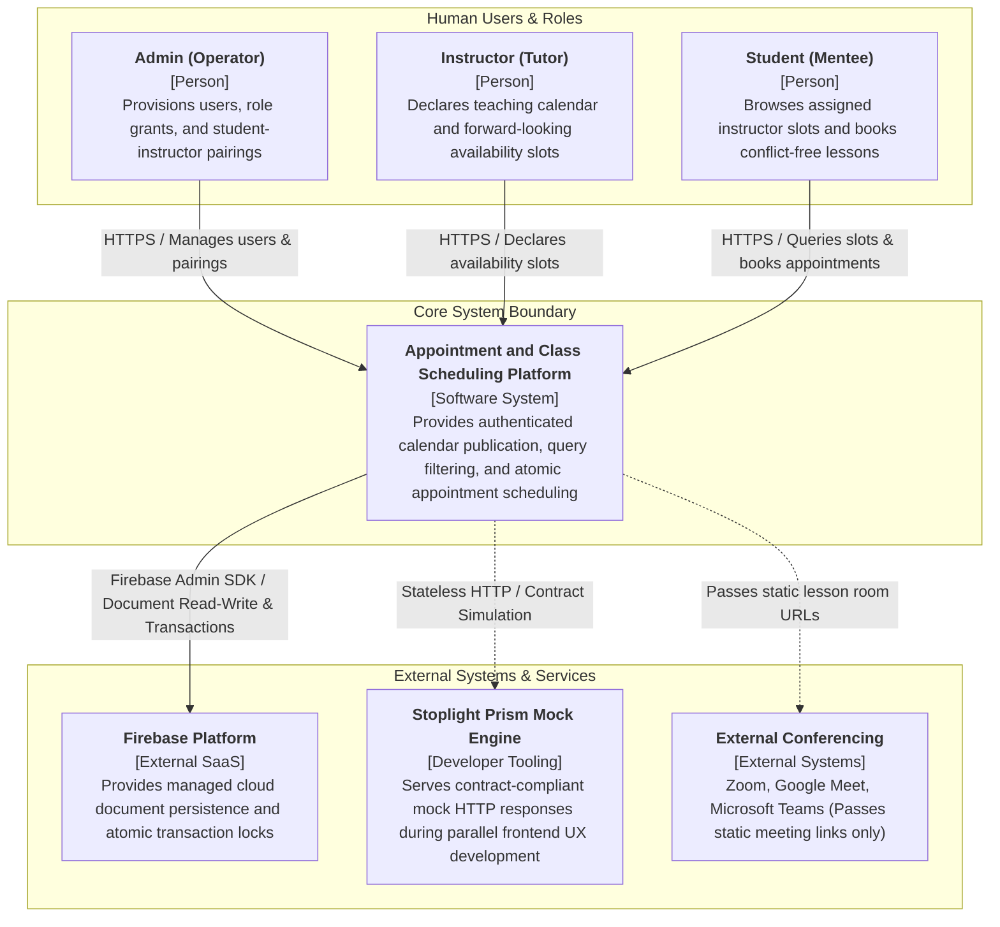
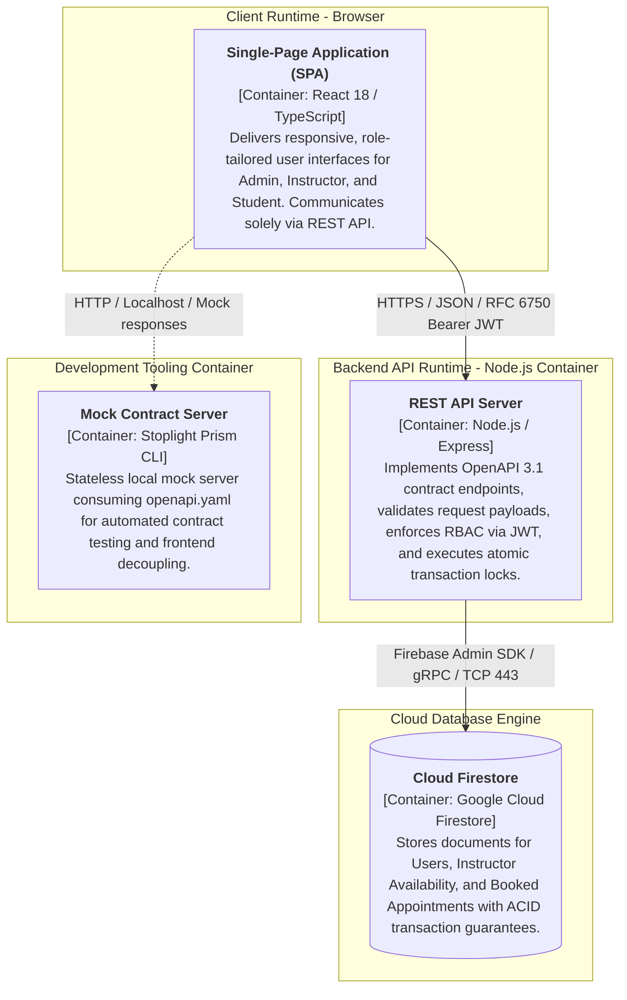
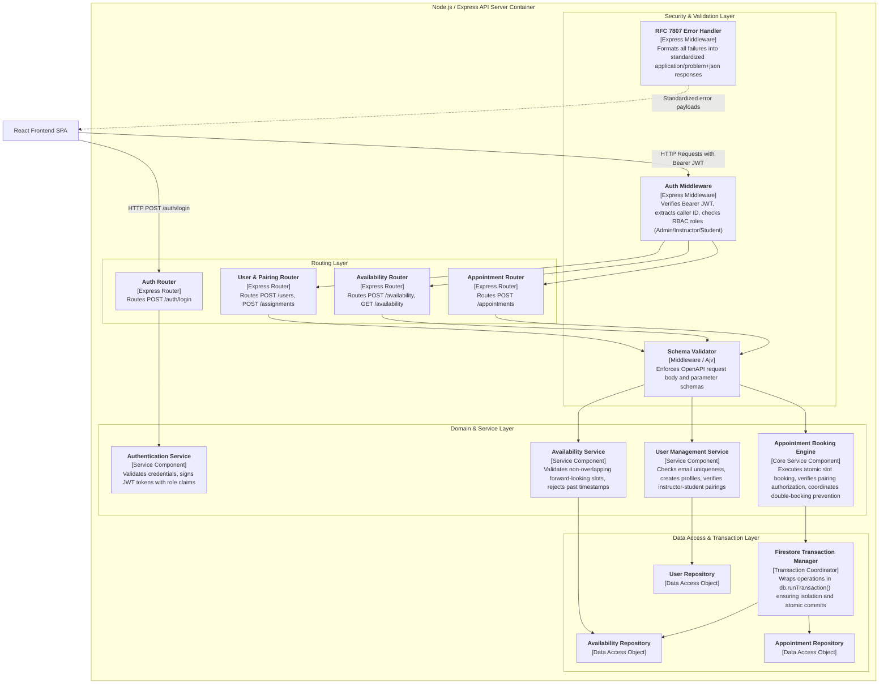

# Software Architecture Specification (C4 Model & ADRs)
## SENG 321 / BM 321 Software Engineering Project — Sprint 2

**Project Name:** Appointment and Class Scheduling System  
**Lead Architect & Technical Lead:** Eren Okat ([@erenokt3](https://github.com/erenokt3) — Student ID: 230204008)  
**Academic Term:** Fall 2026  
**Institution:** Ankara Science University — Department of Computer Engineering  
**API Specification Source:** [`openapi.yaml`](../openapi.yaml) (OpenAPI 3.1.0 — Contract v0.2.1)  

---

## 1. Architectural Overview & Design Philosophy

The **Appointment and Class Scheduling System** is designed on a **Contract-First, Layered Micro-Service / Modular Monolith** architecture. It establishes deterministic scheduling boundaries for private tutoring and academic mentoring, eliminating operational communication overhead and double-booking collisions.

### Core Architectural Principles
1. **Contract-Driven Single Source of Truth:** The OpenAPI 3.1.0 contract (`openapi.yaml`) strictly defines all data models, request/response structures, and HTTP status codes before client or backend implementation commences.
2. **Layered Decoupling:** Presentation, API routing, business domain logic, and persistence layers are strictly isolated. No component accesses data outside its designated boundary layer.
3. **Deterministic Concurrency & Atomicity:** Appointment booking enforces ACID transaction locks at the database engine level (Firebase Firestore Transactions) to prevent race conditions when multiple users attempt simultaneous bookings.
4. **Stateless Zero-Trust Security:** Client identity is derived exclusively from cryptographically verified Bearer JSON Web Tokens (JWT) via server-side claims, strictly prohibiting user ID spoofing through request payload bodies.

---

## 2. C4 Architecture Model

The system architecture is documented using the **C4 model** (Context, Containers, Components, and Code/Deployment), providing hierarchical abstraction for both technical and non-technical stakeholders.

### 2.1 C4 Level 1: System Context Diagram

The System Context diagram illustrates the system's position within the organizational ecosystem, depicting human actors, external dependencies, and primary data boundaries.



---

### 2.2 C4 Level 2: Container Diagram

The Container diagram illustrates the high-level technical building blocks, deployment units, and communication protocols utilized by the platform.



#### Container Responsibilities & Technology Stack
| Container | Primary Technology | Packaging / Docker Target | Protocol / Port | Operational Responsibility |
|:---|:---|:---|:---|:---|
| **Frontend SPA** | React 18, TypeScript, Tailwind CSS, Axios | Docker (`node:22-alpine` build + `nginx:alpine` runner) | HTTPS (Port 443 / 5173 dev / 80 Docker) | Client-side routing, role-based screen rendering, JWT token persistence (in-memory / secure cookie). Zero direct database connection. |
| **Backend API** | Node.js (v22 LTS), Express.js | Docker (`node:22-alpine` runtime) | HTTPS / HTTP (Port 3000 / 8080) | Request validation, authentication claims extraction, business rule validation, atomic database transaction coordination. |
| **Database (Cloud)** | Google Cloud Firestore (Native Mode) | Cloud Managed (GCP) | gRPC / TLS (Port 443) | Document storage for `users`, `availabilities`, `appointments`, and `assignments`. Enforces isolated transaction locks in Production/Staging. |
| **Database (Local Demo)** | Firebase Local Emulator Suite | Docker (`spine3/firebase-emulator` or local CLI) | HTTP / gRPC (Port 8080 Firestore, 9099 Auth) | Fully isolated, zero-credential local persistence container for single-command `docker compose up` grading and demo evaluation. |
| **Mock Engine** | Stoplight Prism CLI | Docker / CLI | HTTP (Port 4010) | Validates frontend client requests against `openapi.yaml` schemas during development without requiring a live backend. |

#### Local Evaluation & Docker-Compose Architecture
To fulfill the BM 321 Software Engineering Project rubric requirement for single-command reproducible evaluation (**20% grading weight**):
- **Reproducible Containerization:** The system specifies multi-container orchestration via `docker-compose.yml` linking Frontend, Backend, and Database containers.
- **Offline Zero-Credential Grading:** Rather than demanding evaluator access to private Google Cloud service accounts, local demo execution leverages the **Firebase Local Emulator Suite**. This ensures that academic juries and instructors can clone the repository and launch the entire platform instantaneously via `docker compose up` without internet connectivity or cloud billing dependencies.

---

### 2.3 C4 Level 3: Component Diagram (Backend API Container)

The Component diagram decomposes the **Node.js / Express REST API Server** into its modular architectural components.



---

## 3. Concurrency Architecture & Double-Booking Mitigation

Double-booking represents the most critical domain risk in appointment scheduling. The system mitigates this through a **Distributed Atomic Read-Modify-Write** cycle powered by Firestore database transactions.

### Concurrency Sequence Model
When two students simultaneously request the same open slot, the system enforces strict serializability:

```mermaid
sequenceDiagram
  autonumber
  actor StudentA as Student A (Client)
  actor StudentB as Student B (Client)
  participant API as Appointment Booking Engine (API)
  participant DB as Firestore Transaction Engine

  Note over StudentA,StudentB: Both students submit POST /appointments for slot_101 simultaneously

  StudentA->>+API: POST /appointments (slotId: slot_101) [JWT: StudentA]
  StudentB->>+API: POST /appointments (slotId: slot_101) [JWT: StudentB]

  API->>+DB: Begin Transaction A (db.runTransaction)
  API->>+DB: Begin Transaction B (db.runTransaction)

  DB-->>API: Tx A: Read slot_101 -> status = "AVAILABLE"
  DB-->>API: Tx B: Read slot_101 -> status = "AVAILABLE"

  Note over DB: Transaction A acquires commit lock first

  API->>DB: Tx A: Write appointment_701 (studentId: StudentA)
  API->>DB: Tx A: Update slot_101 -> status = "BOOKED"
  DB-->>API: Tx A: Commit SUCCESS
  API-->>StudentA: 201 Created (Appointment Confirmed)

  Note over DB: Transaction B attempts commit; detects modified document version (Pessimistic Retrial / Collision)

  DB-->>API: Tx B: Re-reads slot_101 -> status = "BOOKED"
  API->>API: Evaluate Condition: status != "AVAILABLE"
  API-->>DB: Tx B: Rollback & Abort
  API-->>-StudentB: 409 Conflict: SLOT_UNAVAILABLE (RFC 7807)
```

### Concurrency Guarantees
- **Strict Atomicity:** The appointment creation and the slot status change occur as a single atomic unit. It is impossible for an appointment to exist without its corresponding slot being locked.
- **RFC 7807 Problem Details:** Losing transactions fail gracefully with HTTP `409 Conflict` and error code `SLOT_UNAVAILABLE`, preventing silent data corruption or undefined frontend states.

---

## 4. Layered Architecture & Data Flow

The platform implements a **Clean Layered Architecture** ensuring clear separation of concerns:

```
┌────────────────────────────────────────────────────────────────────────┐
│ 1. PRESENTATION LAYER (Client: React 18 SPA)                           │
│    - Role-based UI components (Admin, Instructor, Student)             │
│    - Client-side validation, state stores, Axios HTTP interceptors     │
└───────────────────────────────────┬────────────────────────────────────┘
                                    │ HTTPS / REST (JSON + Bearer JWT)
┌───────────────────────────────────▼────────────────────────────────────┐
│ 2. API & GATEWAY LAYER (Node.js / Express Server)                      │
│    - RFC 6750 Bearer JWT Authentication & Role Verification            │
│    - Schema Validation against OpenAPI 3.1 Specifications              │
│    - RFC 7807 Global Error Handling & Request Logging                  │
└───────────────────────────────────┬────────────────────────────────────┘
                                    │ Internal Controller Invocations
┌───────────────────────────────────▼────────────────────────────────────┐
│ 3. BUSINESS LOGIC & DOMAIN LAYER                                       │
│    - Student-Instructor Pairing Enforcement                            │
│    - Chronological Forward-Looking Availability Checks                 │
│    - Atomic Double-Booking Prevention Engine                           │
└───────────────────────────────────┬────────────────────────────────────┘
                                    │ db.runTransaction() Operations
┌───────────────────────────────────▼────────────────────────────────────┐
│ 4. DATA ACCESS & PERSISTENCE LAYER (Cloud Firestore)                   │
│    - Document collections: users, availabilities, appointments         │
│    - ACID Document-Level Transaction Locking                           │
└────────────────────────────────────────────────────────────────────────┘
```

---

## 5. Architectural Decision Records (ADR)

### ADR-01: Adoption of Contract-First Architecture (OpenAPI 3.1.0)
- **Status:** Accepted (Sprint 1, Reaffirmed Sprint 2)
- **Context:** Parallel development between frontend and backend engineers frequently creates integration mismatches regarding parameter naming, HTTP status codes, and error formats.
- **Decision:** Establish `openapi.yaml` (OpenAPI 3.1.0) as the immutable single source of truth. All endpoints, data schemas, and error models are defined and linted with Redocly CLI before code implementation.
- **Consequences:** Eliminates integration divergence. Enables mock server generation via Stoplight Prism so frontend UI/UX development proceeds concurrently without live backend dependencies.

### ADR-02: Technology Stack & Containerization Strategy
- **Status:** Accepted (Updated for Sprint 2 Evaluation Alignment)
- **Context:** The system requires rapid prototyping, responsive multi-role interfaces, zero cloud infrastructure cost, robust document-level concurrency controls, and single-command local reproducibility (`docker compose up`) mandated by the course grading rubric.
- **Decision:**
  - **Frontend:** React 18 with TypeScript, packaged as a multi-stage Docker container (`node:22-alpine` build stage $\rightarrow$ `nginx:alpine` runtime).
  - **Backend:** Node.js 22 LTS with Express.js, packaged as an Alpine Docker container (`node:22-alpine`). Upgraded to Node 22 to fulfill `firebase-admin` (v14+) engine prerequisites and account for Node 20 LTS reaching End-of-Life in April 2026.
  - **Production Database:** Google Cloud Firestore (Native Mode) for managed cloud document persistence.
  - **Local Demo & Evaluation Database:** Firebase Local Emulator Suite (`firebase-tools`), orchestrated alongside frontend and backend containers via `docker-compose.yml`.
- **Consequences:** Eliminates external GCP account dependencies for evaluators and grading juries. Guarantees 100% reproducible execution via a single `docker compose up` command while retaining native atomic transaction locks (`runTransaction`) across both local emulator and production cloud environments.

### ADR-03: Concurrency Control Strategy via Atomic Transactions
- **Status:** Accepted
- **Context:** When multiple students simultaneously attempt to book the identical availability slot, traditional non-transactional database updates result in double-booking collisions.
- **Decision:** Utilize Firestore's atomic transaction engine (`db.runTransaction()`). The booking operation executes a conditional check (`slot.status === 'AVAILABLE'`) and writes both the appointment record and the slot status transition atomically.
- **Consequences:** 100% collision prevention. Contended transactions fail gracefully, returning standardized `409 Conflict: SLOT_UNAVAILABLE` payloads.

### ADR-04: Stateless JWT Authentication & Server-Side Claims Derivation
- **Status:** Accepted
- **Context:** Client requests must be authenticated across all operational routes without server-side session state overhead, and unauthorized role elevation or caller spoofing must be strictly prevented.
- **Decision:** Enforce RFC 6750 Bearer JWT tokens. All protected endpoints extract user identity (`userId`) and role (`role`) directly from cryptographically signed JWT token claims. The API server strictly prohibits accepting `studentId` or `callerId` as client-controlled request payload fields.
- **Consequences:** Guarantees zero-trust caller verification. Protects role boundaries (Admin, Instructor, Student) with zero session synchronization complexity.

---

## 6. Traceability to Sprint 2 Deliverables & Rubric Alignment

| BM321 Sprint 2 Requirement | Architectural Implementation | Reference Location |
|:---|:---|:---|
| **C4 System Context Model** | C4 Level 1 diagram detailing system actors, core platform, and external systems | Section 2.1 |
| **C4 Container Model** | C4 Level 2 diagram detailing React SPA, Node API, Firestore DB, and Prism Mock | Section 2.2 |
| **C4 Component Model** | C4 Level 3 diagram decomposing the API Server into routers, services, and transaction manager | Section 2.3 |
| **Concurrency & Quality Measures** | Atomic transaction sequence flow preventing double-bookings with RFC 7807 409 responses | Section 3 |
| **Architectural Decision Records** | Formal ADRs justifying API-First, Tech Stack, Concurrency, and Stateless Security | Section 5 |
| **OpenAPI Contract Synchronization** | 100% adherence to OpenAPI 3.1 endpoints and RFC 7807 problem json structures | [`openapi.yaml`](../openapi.yaml) |
