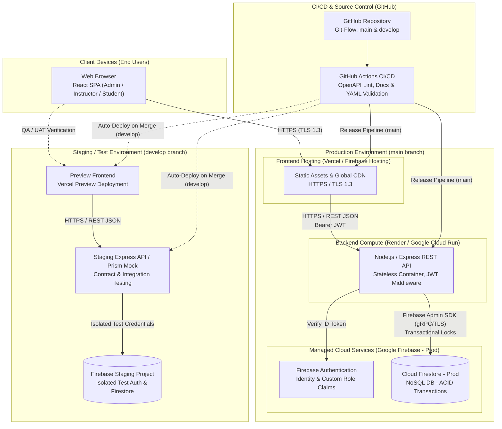

# C4 Deployment Architecture (Diagram 4)

## 1. Overview
This document defines the **C4 Level 4 (Deployment) Architecture** for the **Appointment and Class Scheduling System**. It maps the system's software containers (React Frontend, Node.js/Express REST API, and Firebase Firestore) to physical and cloud execution environments, detailing **Production** and **Staging** isolation, communication protocols, and CI/CD automation.

## 2. Deployment Topology Diagram

## 3. Infrastructure Nodes & Responsibilities

| Deployment Node | Cloud Provider / Platform | Hosted Container / Artifact | Responsibility & Scaling Strategy |
| :--- | :--- | :--- | :--- |
| **Frontend Edge / CDN** | Vercel / Firebase Hosting | React Single-Page Application (SPA) | Serves static bundles globally over HTTPS (TLS 1.3) with automated edge caching and instant rollback support. |
| **Backend Compute Node** | Render / Google Cloud Run | Node.js & Express REST API | Runs stateless API containers handling JWT verification, RBAC authorization, and scheduling business logic. Auto-scales horizontally based on HTTP request concurrency. |
| **Identity Provider** | Firebase Authentication | Managed Auth Service | Issues signed Bearer JWTs containing custom role claims (`admin`, `instructor`, `student`) to prevent ID spoofing. |
| **Primary Data Store** | Google Cloud Firestore | Managed NoSQL Document Database | Stores users, pairings, availability slots, and appointments. Executes atomic ACID transactions to enforce 100% double-booking prevention (`409 Conflict`). |
| **CI/CD Automation** | GitHub Actions | Workflow Runners (`ubuntu-latest`) | Enforces quality gates on every Pull Request (OpenAPI contract linting, Markdown & YAML syntax validation, and future automated test suites). |

## 4. Environment Isolation Strategy

To guarantee system stability and protect live scheduling data, environments are strictly segregated across Git-Flow branches:

| Environment | Git Branch | Frontend URL Target | Backend & Database Target | Purpose |
| :--- | :--- | :--- | :--- | :--- |
| **Local Development** | `feature/*` | `localhost:3000` | Local Express / Prism Mock / Firebase Emulator | Isolated developer implementation and unit testing. |
| **Staging / QA** | `develop` | Vercel Preview URL | Staging Compute + Separate Firebase Staging Project | Integration testing, QA verification, and UAT prior to release. |
| **Production** | `main` (Tagged Releases) | Production Custom Domain | Production Compute + Production Firebase Project | Live system serving university admins, instructors, and students. |

## 5. Security Boundaries & Secret Management

* **Transport Security:** All external client-to-edge and edge-to-API communications enforce **HTTPS (TLS 1.3)** with strict CORS policies whitelisting only the deployed frontend origins.
* **Zero Direct Client-to-DB Writes:** Firestore Security Rules deny direct client-side write mutations; all state-changing operations (slot creation, appointment booking) must traverse the Express API to enforce server-side validation and transactional locking.
* **Secret Isolation:** Firebase Admin SDK service account keys and JWT configuration values are never committed to Git. They are injected exclusively at runtime via encrypted platform environment variables (Render/Cloud Run Secrets & GitHub Encrypted Secrets).
* **Least-Privilege CI/CD:** GitHub Actions workflows execute with read-only repository token scopes (`permissions: contents: read`) unless an explicit release step requires elevated permissions.