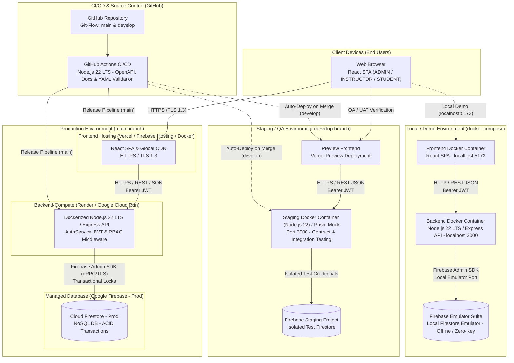

# C4 Deployment Architecture (Diagram 4)

## 1. Overview
This document defines the **C4 Level 4 (Deployment) Architecture** for the **Appointment and Class Scheduling System**. Aligned with `openapi.yaml` (`v0.3.0`) and **ADR-02 (Node.js 22 LTS)**, it maps the containerized software components (React Frontend, Node.js 22 / Express REST API, and Cloud Firestore) across **Local/Demo (`docker-compose`)**, **Staging**, and **Production** environments, detailing communication protocols, security boundaries, and CI/CD automation.

## 2. Deployment Topology Diagram

## 3. Infrastructure Nodes & Responsibilities

| Deployment Node | Cloud Provider / Runtime | Hosted Container / Artifact | Responsibility & Scaling Strategy |
| :--- | :--- | :--- | :--- |
| **Local / Demo Stack** | Docker Engine (`docker-compose`) | Frontend Image (`:5173`), Backend Image (`:3000`), Firebase Emulator Suite | Enables single-command local execution and final demo evaluation without external internet access or exposed cloud service-account keys. |
| **Frontend Edge / CDN** | Vercel / Firebase Hosting (or Docker Nginx) | React Single-Page Application (SPA) | Serves static production bundles globally over HTTPS (TLS 1.3) with automated edge caching and instant rollback support. |
| **Backend Compute Node** | Render / Google Cloud Run | Dockerized Node.js 22 LTS & Express REST API | Runs stateless API containers hosting `AuthService` (`POST /auth/login` JWT issuance and verification), RBAC middleware (`ADMIN`, `INSTRUCTOR`, `STUDENT`), and scheduling logic. Auto-scales horizontally based on HTTP concurrency. |
| **Primary Data Store** | Google Cloud Firestore | Managed NoSQL Document Database | Stores users, pairings, availability slots, and appointments. Executes atomic ACID transactions to enforce 100% double-booking prevention (`409 SLOT_UNAVAILABLE`). |
| **CI/CD Automation** | GitHub Actions | Workflow Runners (`ubuntu-latest`, Node.js 22 LTS) | Enforces automated quality gates on every Pull Request (OpenAPI `v0.3.0` contract linting, Markdown structural checks, YAML syntax validation, and automated test suites). |

## 4. Environment Isolation & Port Strategy

To guarantee system stability, protect live scheduling data, and support single-command demo reproducibility, environments are strictly segregated:

| Environment | Git Branch / Trigger | Frontend Target | Backend & Mock Target | Database Target | Purpose |
| :--- | :--- | :--- | :--- | :--- | :--- |
| **Local / Demo (`docker-compose`)** | `feature/*` or Final Release | `localhost:5173` (Docker Container) | `localhost:3000` (Express Docker Container / Prism Mock) | Firebase Emulator Suite (Local Container) | Single-command offline demo, isolated development, and automated integration tests. |
| **Staging / QA** | `develop` | Vercel Preview URL | Staging Docker Container (`Node.js 22 LTS`) | Separate Firebase Staging Project | Contract verification, QA testing, and UAT prior to release. |
| **Production** | `main` (Tagged Releases) | Production Custom Domain | Production Docker Container (`Render` / `Cloud Run`) | Production Firebase Project | Live system serving university `ADMIN`, `INSTRUCTOR`, and `STUDENT` users. |

## 5. Security Boundaries & Secret Management

* **Transport Security:** All external client-to-edge and edge-to-API traffic enforces **HTTPS (TLS 1.3)** with strict CORS policies whitelisting only trusted frontend origins.
* **Backend-Issued JWT & RBAC:** The Express backend (`AuthService` via `POST /auth/login`) is the sole authority for signing and verifying Bearer JWTs containing uppercase role claims (`ADMIN`, `INSTRUCTOR`, `STUDENT`). Protected endpoints enforce server-side authentication (`401 Unauthorized`) and role-based authorization (`403 Forbidden`) to prevent client-side ID spoofing.
* **Zero Direct Client-to-DB Writes:** Firestore Security Rules deny direct client-side write mutations; all state-changing operations (slot creation, appointment booking) traverse the Express API via the Firebase Admin SDK to enforce business validation and transactional locking.
* **Secret Isolation & Zero-Key Demo:** `JWT_SECRET` and Firebase Admin SDK service-account keys are never committed to Git. Production and Staging secrets are injected strictly via encrypted runtime environment variables (Render/Cloud Run Secrets & GitHub Encrypted Secrets), while the Local/Demo environment relies exclusively on the **Firebase Emulator Suite** so the public repository remains completely free of credentials.
* **Least-Privilege CI/CD:** GitHub Actions workflows execute on **Node.js 22 LTS** with read-only repository token scopes (`permissions: contents: read`) unless an explicit release step requires elevated permissions.