# UI/UX Specification (Sprint 2)

**Project:** Appointment and Class Scheduling System
**Owner:** Ayşe Nida Yalçınkaya (Scrum Master & Agile Process Coach), Responsible/Accountable for UI/UX, see [RACI Matrix](RACI_Matrix.md)
**Consulted:** Miraç Burak Esentürk (Product Owner), Eren Okat (Lead Software Architect), Furkan Çelebi (Implementation & Integration Engineer)
**API Contract Reference:** `openapi.yaml` (v0.3.0)
**Related Documents:** [`Architecture.md`](Architecture.md), [`system-boundary.md`](system-boundary.md), [`RACI_Matrix.md`](RACI_Matrix.md), [`openapi.yaml`](../openapi.yaml)
**Figma File (view only):** https://www.figma.com/design/M6LAc9CPvoRaUDgIyz8zIP/

---

## 1. Purpose

This document describes the screens, user flows and visual rules for the MVP. It connects every screen to the API endpoint it uses, so the frontend can be built against the Prism mock before the backend is ready.

---

## 2. Scope

In scope this sprint:

- Login for all three roles (ADMIN, INSTRUCTOR, STUDENT)
- Admin: create users, assign a student to an instructor
- Instructor: add availability slots, delete unbooked slots
- Student: view available slots of the assigned instructor, book one
- Mobile layouts for the student and instructor screens

Not in scope this sprint (agreed with the Product Owner):

- Appointment history and cancellation
- Profile editing
- Payments, notifications, video meetings (see `docs/system-boundary.md`)

Scope rules that affect the UI:

- A student sees only AVAILABLE slots. Booked slots are not shown to students.
- An instructor can delete only slots that are not booked. Booked slots have no Delete button.
- Each student has exactly one instructor. Only the admin can change the pairing.

---

## 3. Visual Style

### 3.1 Colors

| Role | Hex | Used for |
|---|---|---|
| Primary (deep navy) | `#0F2A4A` | Buttons, login side panel, selected day, role badges |
| Primary dark | `#0B1F38` | Headings and emphasized text |
| Primary light | `#EDF1F7` | Selected menu item, light backgrounds |
| Primary border | `#DCE4EF` | Card and input borders |
| Muted navy | `#8FA3BF` | Secondary icons, illustration |
| Soft navy | `#C9D4E3` | Dividers, disabled states |
| Success | `#047857` | Available slots, success messages |
| Error | `#B91C1C` | Error text, Delete button |
| Error background | `#FEF2F2` | Error message box |
| Error border | `#FCA5A5` | Error message box border |

Green and red are used only for meaning (available / success and error / delete), never for decoration.

### 3.2 Components

- **Buttons:** primary buttons use the deep navy fill with white text. Destructive actions (Delete) use red.
- **Inputs:** label above the field, error text below the field in red.
- **Slot cards:** show time range and status. AVAILABLE in green. BOOKED in grey, without actions.
- **Messages:** errors appear inline next to the related field or at the top of the form, never as pop-up alerts.

---

## 4. Screen Inventory

| ID | Screen | Role | API | Description |
|---|---|---|---|---|
| 1a | Login | All | `POST /auth/login` | Email and password form |
| 1b | Login validation error | All | – | Empty field message ("Email is required") |
| 1c | Login failed | All | `POST /auth/login` → 401 | "Invalid email or password" |
| 2a | Admin – Create user | ADMIN | `POST /users` | Name, email, password, role |
| 2b | Admin – Assign student | ADMIN | `GET /users?role=`, `POST /assignments` | Pick a student and an instructor, save pairing |
| 2c | Admin – Create user error | ADMIN | `POST /users` → 400 / 409 | Form errors, email already in use |
| 3a | Instructor – Availability | INSTRUCTOR | `GET /availability`, `POST /availability`, `DELETE /availability/{id}` | Weekly calendar, add and delete slots |
| 3b | Instructor – Availability errors | INSTRUCTOR | `POST /availability` → 400 | Past date, end time before start time |
| 3m | Instructor – Mobile | INSTRUCTOR | Same as 3a | Month calendar, slot list, Add slot, Delete on available slots |
| 4a | Student – Book appointment | STUDENT | `GET /availability` | Available slots of the assigned instructor, confirmation card |
| 4b | Student – Booking success | STUDENT | `POST /appointments` → 201 | Confirmation of the booked slot |
| 4c | Student – Slot taken | STUDENT | `POST /appointments` → 409 | Slot was booked by someone else, calendar refreshed |
| 4m | Student – Mobile | STUDENT | Same as 4a | Month calendar, slot list with Book buttons |

After login the app routes the user by the `role` field in the login response (`token`, `userId`, `name`, `role`).

---

## 5. User Flows

### 5.1 Login and student booking

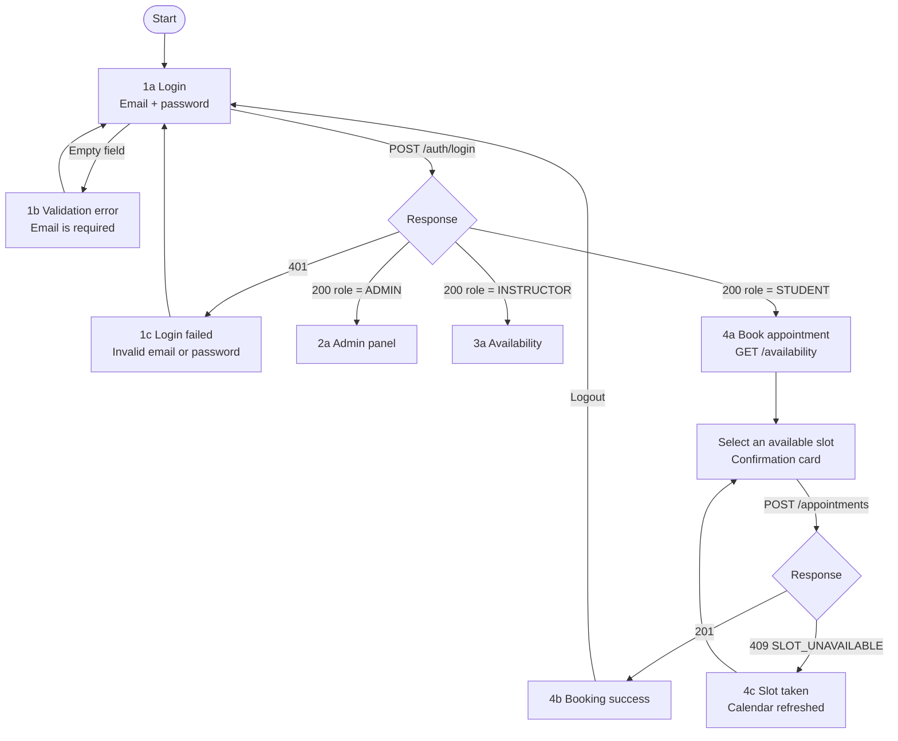

### 5.2 Admin

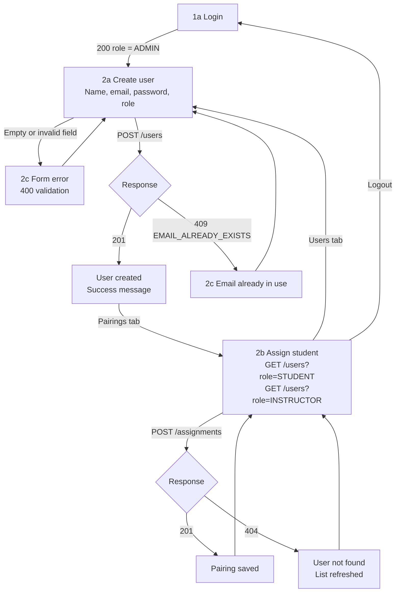

### 5.3 Instructor

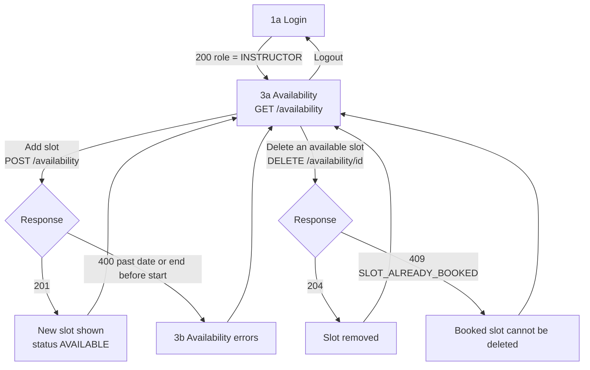

Mobile screens 4m (student) and 3m (instructor) follow the same flows. The weekly grid is replaced by a month calendar and a slot list.

---

## 6. Error Handling in the UI

The API returns errors in RFC 7807 format with a `code` field. The UI maps them as follows:

| Code / status | Screen | Message shown |
|---|---|---|
| 400 validation | 1b, 2c, 3b | Field-level message under the input |
| 401 | 1c | "Invalid email or password" |
| 401 on other pages | any | Session expired, redirect to 1a |
| 403 FORBIDDEN | any | "You don't have permission for this action" |
| 403 INSTRUCTOR_NOT_ASSIGNED | 4a | "No instructor assigned yet. Please contact the admin." |
| 404 SLOT_NOT_FOUND | 4a, 3a | Slot no longer exists, list refreshed |
| 409 EMAIL_ALREADY_EXISTS | 2c | "This email is already in use" |
| 409 SLOT_UNAVAILABLE | 4c | "This slot was just booked. Please choose another one." |
| 409 SLOT_ALREADY_BOOKED | 3a | "Booked slots cannot be deleted" |

---

## 7. Prototype

The Figma file has three clickable flows:

| Flow | Start frame | Path |
|---|---|---|
| Student booking flow | 1a | Sign in → 4a → Book appointment → 4b → Logout → 1a |
| Admin flow | 2a | Pairings → 2b → Users → 2a |
| Instructor flow | 3a | Availability screen |

To open: Figma file → Present (▶) → choose the flow from the list on the left.

---

## 8. Responsive Behavior

- **Desktop (≥ 1024 px):** left sidebar navigation, weekly calendar grid.
- **Mobile (< 768 px):** sidebar is hidden, month calendar on top, slot list for the selected day below it.
- Touch targets on mobile are at least 44 px high.
- Only web browsers are targeted (no native app), as stated in `docs/system-boundary.md`.

---

## 9. Accessibility

- Text and button colors on white meet WCAG AA contrast (deep navy `#0F2A4A` on white).
- Status is never shown by color alone: every slot also has a text label (Available / Booked).
- Every input has a visible label, not only a placeholder.
- Error messages are placed next to the field they belong to.

---

## 10. Screenshots

Exported from Figma into `docs/ui/`.

| Screen | File |
|---|---|
| 1a Login | 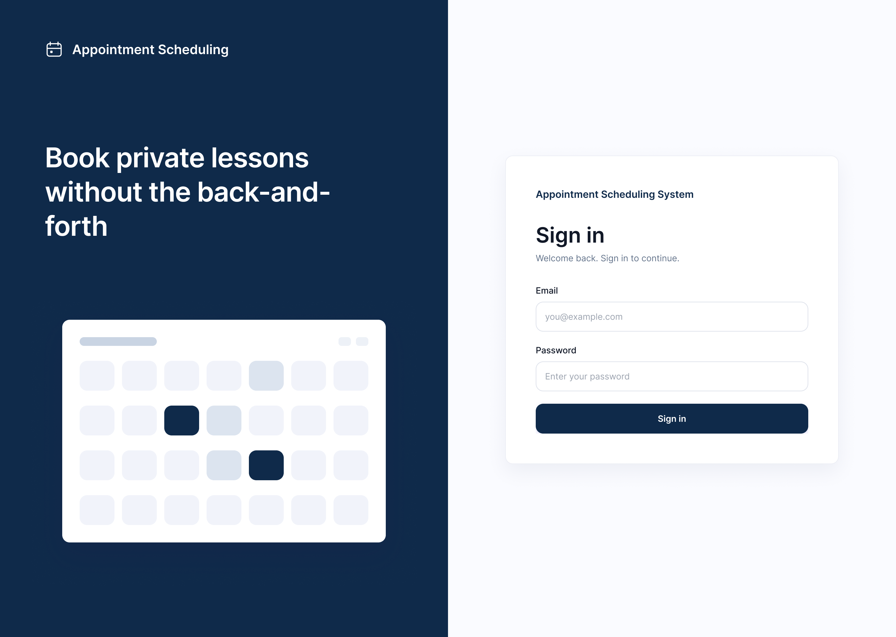 |
| 1b Login validation error |  |
| 1c Login failed | 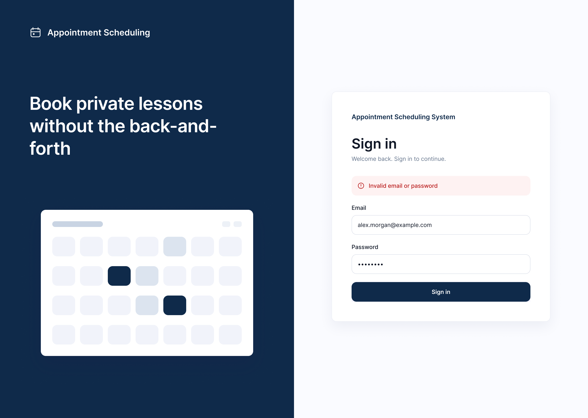 |
| 2a Create user | 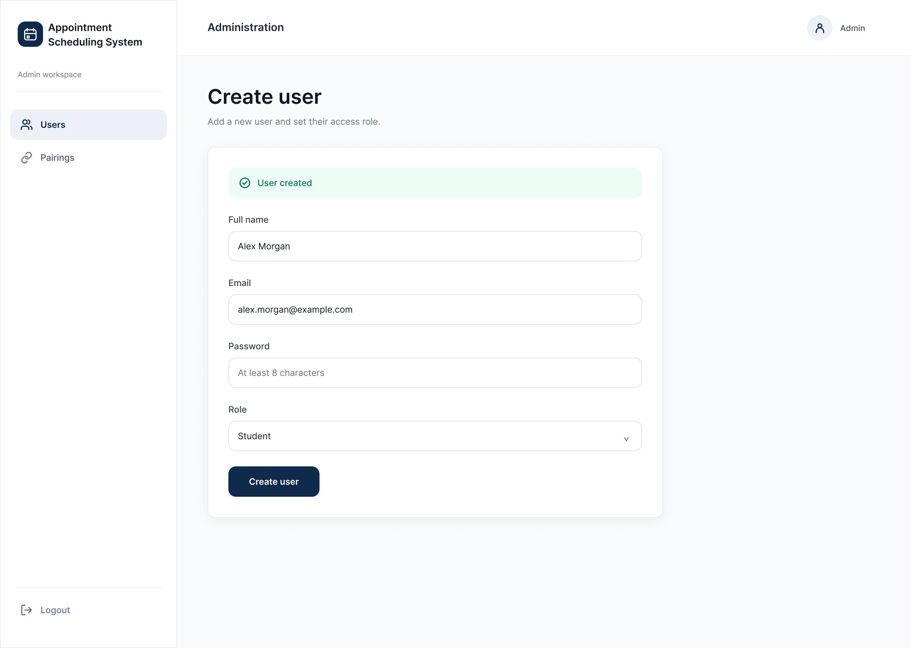 |
| 2b Assign student | 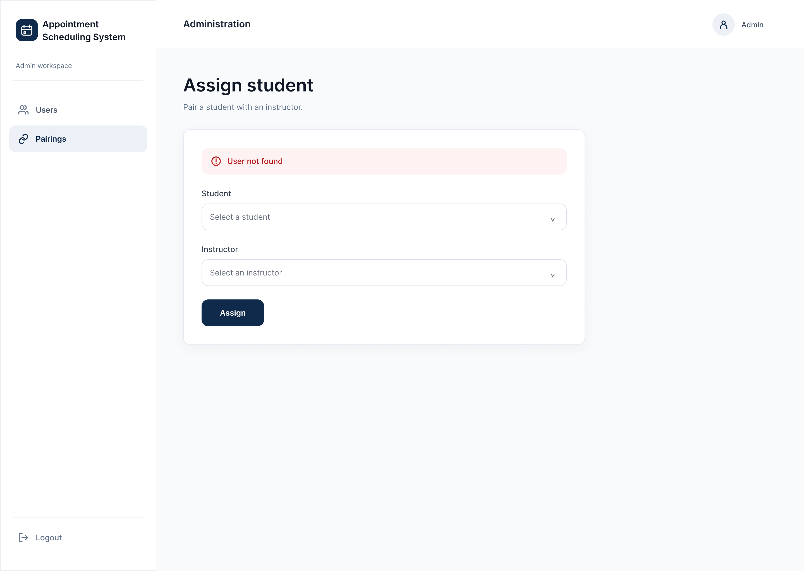 |
| 2c Create user error | 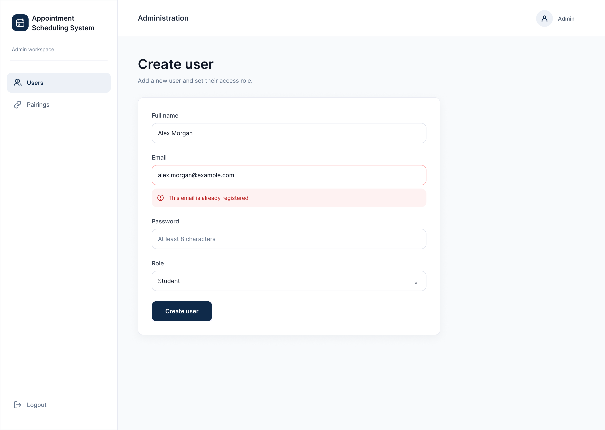 |
| 3a Availability | 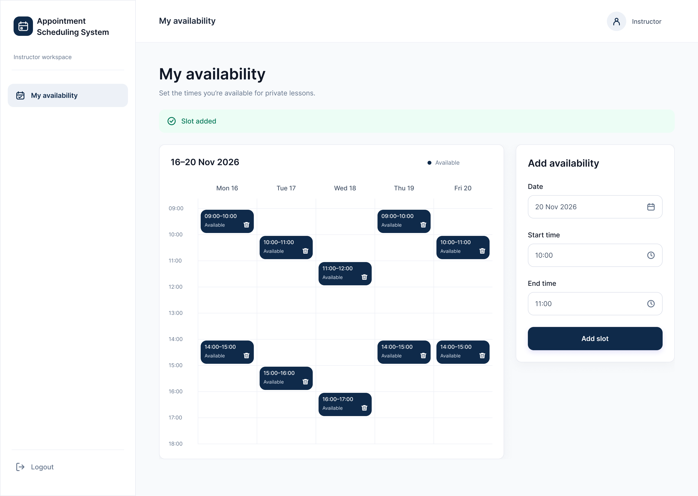 |
| 3b Availability errors | 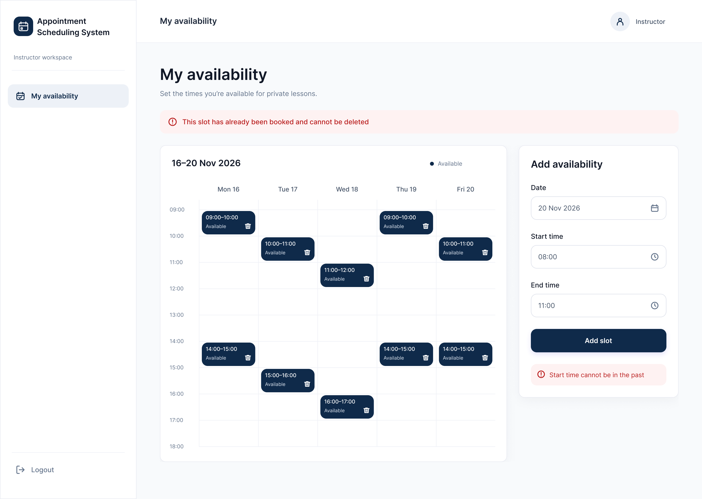 |
| 3m Instructor mobile | 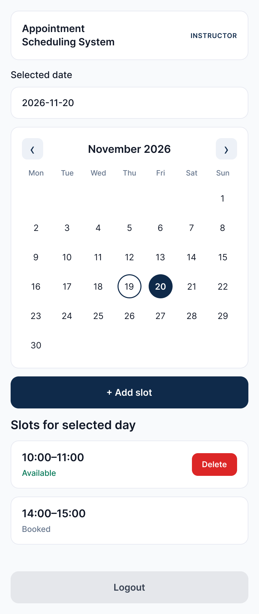 |
| 4a Book appointment | 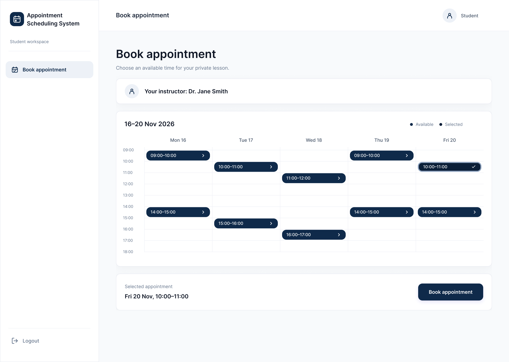 |
| 4b Booking success | 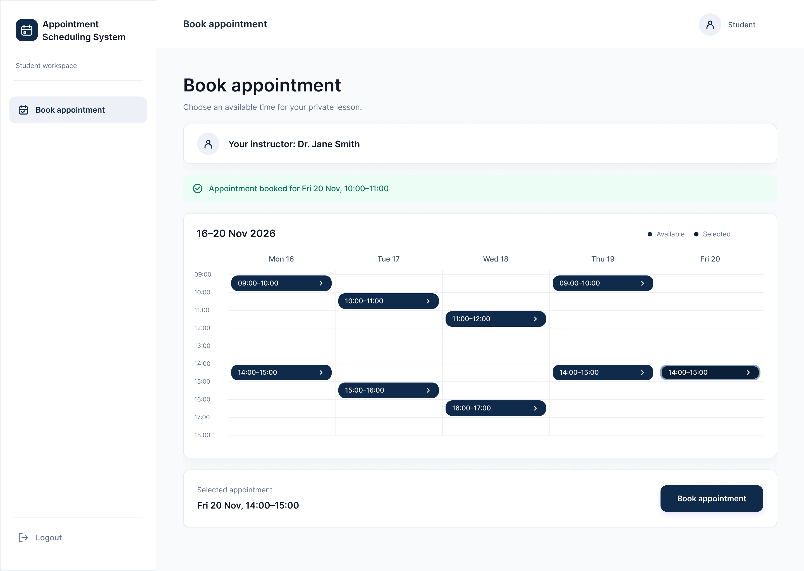 |
| 4c Slot taken | 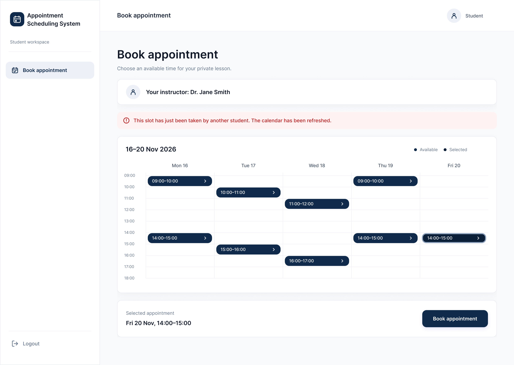 |
| 4m Student mobile | 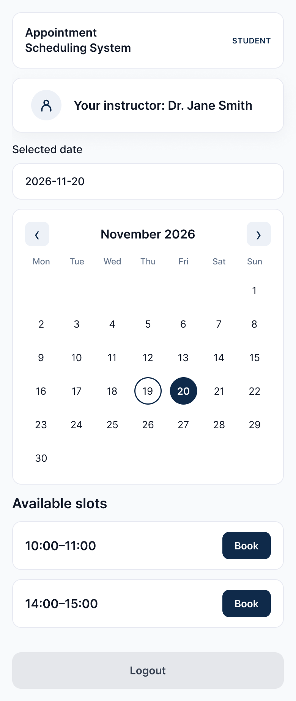 |
