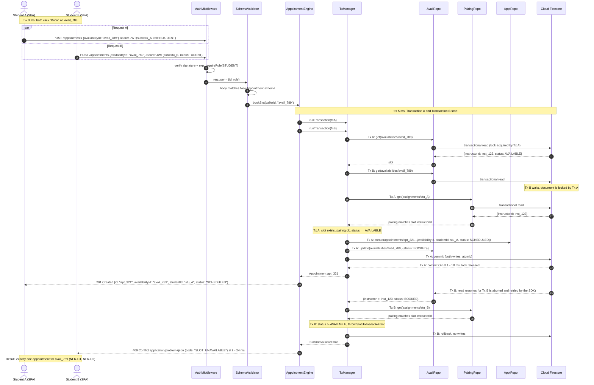
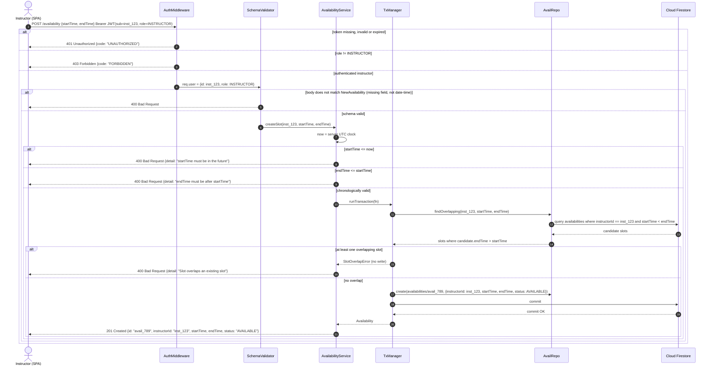
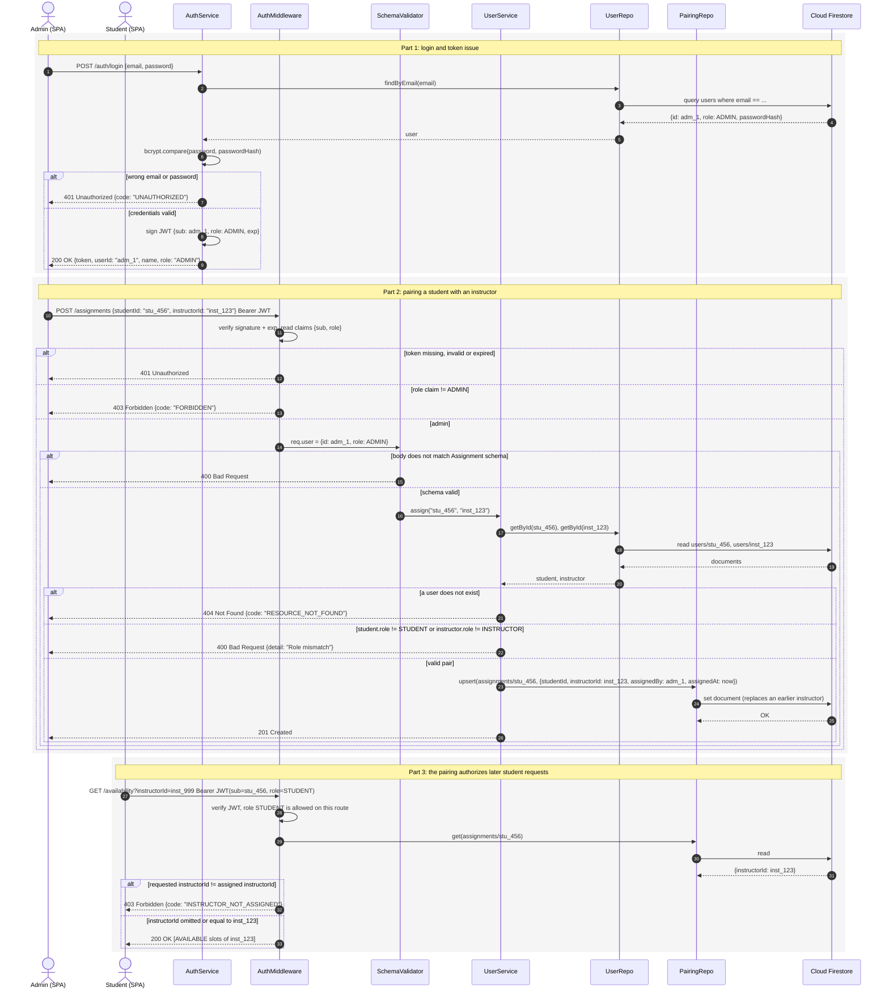
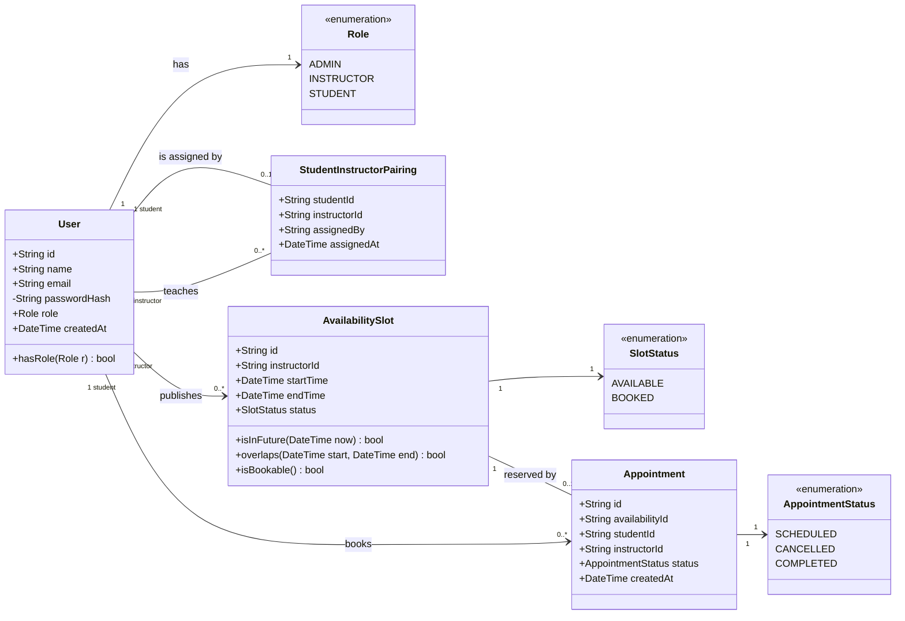

# UML Dynamic Behaviour and Domain Model (Sprint 2)

**Project:** Appointment and Class Scheduling System
**Owner:** Furkan Çelebi (Implementation & Integration Engineer)
**Approver:** Eren Okat (Lead Software Architect), see [RACI Matrix](RACI_Matrix.md)
**API Contract Reference:** `openapi.yaml` (v0.3.0)
**Related Documents:** [`Architecture.md`](Architecture.md), [`API_Integration_Strategy.md`](API_Integration_Strategy.md), [`QA_Strategy.md`](QA_Strategy.md)

This document refines the architecture into UML models that the backend implementation follows directly:

- three **sequence diagrams** for the critical runtime flows, drawn at component level, and
- one **domain / class diagram** for the persisted entities and their relations.

Participant names match the C4 Level 3 components in [`Architecture.md` §2.3](Architecture.md#23-c4-level-3-component-diagram-backend-api-container). Field names, enum values, status codes and error codes match `openapi.yaml` v0.3.0, which stays the single source of truth. Where a diagram needs a rule the contract does not express yet, it is listed in [§6 Open Points](#6-open-points-for-the-contract-and-srs).

---

## 1. Conventions

| Item | Convention |
| :--- | :--- |
| Identity | The caller's `userId` and `role` are read only from the verified JWT claims (`sub`, `role`), never from the request body (ADR-04). |
| Errors | Every failure is returned as `application/problem+json` with `title`, `status`, `code` and `detail` (RFC 7807), produced by the global `ErrorHandler`. |
| Time | All timestamps are ISO-8601 UTC. "Now" is the server clock at request time. |
| Collections | Firestore collections are `users`, `assignments`, `availabilities` and `appointments` (see [§5](#5-firestore-persistence-mapping)). |
| Timings | Millisecond values in §2 are illustrative, to show ordering. They are not measurements. Performance targets are defined in `NFR_Quality_Measures.md`. |

---

## 2. Sequence Diagram 1: Double-Booking Prevention (US-05, `POST /appointments`)

Two students who are assigned to the same instructor press **Book** on the same `AVAILABLE` slot `avail_789` within the same few milliseconds. `Architecture.md` §3 shows this at system level. The diagram below shows the same flow through each backend component.

The booking runs inside `db.runTransaction()`. The Firebase Admin SDK uses **pessimistic locking** on the server side: a document read inside a transaction is locked until that transaction commits or aborts. A competing transaction therefore cannot commit a write against the same slot snapshot. If it is aborted because of contention, the SDK retries the whole transaction function automatically, and the retry reads the committed `BOOKED` state.

### 2.1 Decision order inside the transaction

The transaction function checks the following, in this order. The first rule that fails ends the transaction without any write.

| Step | Check | Failure response |
| :---: | :--- | :--- |
| 1 | JWT is present, correctly signed and not expired | `401 UNAUTHORIZED` (before the transaction) |
| 2 | `role == STUDENT` | `403 FORBIDDEN` (before the transaction) |
| 3 | Body has `availabilityId` (string) | `400` (before the transaction) |
| 4 | `availabilities/{availabilityId}` exists | `404 SLOT_NOT_FOUND` |
| 5 | `assignments/{callerId}.instructorId == slot.instructorId` | `403 INSTRUCTOR_NOT_ASSIGNED` |
| 6 | `slot.status == AVAILABLE` | `409 SLOT_UNAVAILABLE` |
| 7 | Create the appointment and set the slot to `BOOKED` in one commit | `201 Created` |

Steps 4 to 6 read inside the transaction, so a pairing change or a competing booking that commits first is always seen.

---

## 3. Sequence Diagram 2: Publishing Availability with Past-Date Validation (US-03, `POST /availability`)

An instructor publishes a new slot. The backend rejects it when it starts in the past, when `endTime` is not after `startTime`, or when it overlaps one of the instructor's existing slots. The overlap query and the insert run in one transaction, so two parallel requests from the same instructor cannot both create overlapping slots.

### 3.1 Validation rules

| Rule | Where it is enforced | Reason |
| :--- | :--- | :--- |
| `instructorId` comes from the token | `AuthMiddleware` → `req.user.id` | `NewAvailability` has no `instructorId`, so one instructor cannot create slots for another. |
| `startTime` and `endTime` are valid `date-time` strings | `SchemaValidator` | Contract shape check, done before any business logic. |
| `startTime > now` | `AvailabilityService` | Depends on the server clock, so a stateless mock cannot check it (`API_Integration_Strategy.md`). |
| `endTime > startTime` | `AvailabilityService` | Chronological order (NFR-R3). |
| No overlap with the instructor's existing slots | `AvailabilityService` inside the transaction | SRS FR-05 rule 4. Two intervals overlap when `a.start < b.end` and `a.end > b.start`. |

---

## 4. Sequence Diagram 3: Authorization and Student-Instructor Pairing (US-02, `POST /assignments`)

The admin logs in, receives a JWT that contains the role claim, and assigns a student to an instructor. The second part shows how the stored pairing is used later to authorize a student request. This is the same check that protects `POST /appointments`.

Part 3 shows the authorization step in `AuthMiddleware` to keep the diagram short. In the code, the pairing lookup is done by the availability and appointment services, with `req.user` set by the middleware.

### 4.1 Authorization matrix derived from the JWT `role` claim

| Endpoint | ADMIN | INSTRUCTOR | STUDENT |
| :--- | :---: | :---: | :---: |
| `POST /auth/login` | public | public | public |
| `GET /users`, `POST /users` | ✅ | `403` | `403` |
| `POST /assignments` | ✅ | `403` | `403` |
| `GET /availability` | `403` | ✅ own slots | ✅ assigned instructor only |
| `POST /availability` | `403` | ✅ | `403` |
| `DELETE /availability/{id}` | `403` | ✅ own, `AVAILABLE` only | `403` |
| `POST /appointments` | `403` | `403` | ✅ assigned instructor only |

---

## 5. Domain / Class Diagram

The diagram shows the domain entities, their attributes, and how they relate. `Role`, `SlotStatus` and `AppointmentStatus` are the enums defined in `openapi.yaml`. `passwordHash`, `assignedBy`, `assignedAt` and `createdAt` are stored by the backend but never returned by the API.

### 5.1 Relationships and invariants

| Relationship | Multiplicity | Invariant enforced by the backend |
| :--- | :--- | :--- |
| Student to pairing | 1 to 0..1 | A student has at most one active instructor. The pairing document id is the `studentId`, so a new assignment replaces the old one (SRS FR-04). |
| Instructor to pairing | 1 to 0..* | An instructor can teach many students. |
| Pairing roles | - | `studentId` points to a `STUDENT` user and `instructorId` to an `INSTRUCTOR` user. |
| Instructor to slot | 1 to 0..* | `slot.instructorId` always comes from the creating instructor's token. Slots of one instructor never overlap. |
| Slot to appointment | 1 to 0..1 | A slot is `BOOKED` exactly when it has a `SCHEDULED` appointment. Both are written in one transaction (ADR-03). |
| Student to appointment | 1 to 0..* | `appointment.studentId` always comes from the token (NFR-S3). The student must be paired with `slot.instructorId` at booking time. |
| Slot deletion | - | A slot can be deleted only by its owner and only while it is `AVAILABLE`; otherwise `409 SLOT_ALREADY_BOOKED`. |

`Appointment.instructorId` is a denormalised copy of `slot.instructorId`. It lets an instructor list their appointments without reading each slot. The contract does not return it yet.

### 5.2 Firestore persistence mapping

| Entity | Collection | Document id | Indexed query fields |
| :--- | :--- | :--- | :--- |
| `User` | `users` | generated (`usr_…`) | `email` (stored lower-case), `role` |
| Email uniqueness index | `userEmails` | `sha256(email)` | none. Written together with the user in one batch `create()`, which fails with `ALREADY_EXISTS` for a taken email (`409 EMAIL_ALREADY_EXISTS`) |
| `StudentInstructorPairing` | `assignments` | `studentId` | `instructorId` |
| `AvailabilitySlot` | `availabilities` | generated (`avail_…`) | `instructorId` + `startTime`, `status` |
| `Appointment` | `appointments` | generated (`apt_…`) | `studentId`, `instructorId`, `availabilityId` |

---

## 6. Open Points for the Contract and SRS

These do not block implementation. They are listed so that `openapi.yaml`, `SRS.md` and these diagrams stay consistent.

1. **Specific `400` error codes.** The contract's `BadRequest` response has no fixed `code`. The backend will send `VALIDATION_ERROR` for schema failures and proposes `SLOT_IN_PAST`, `INVALID_TIME_RANGE` and `SLOT_OVERLAP` for availability rules, and `ROLE_MISMATCH` for assignments. These should be added to `openapi.yaml` as examples in a later minor version.
2. **Naming in the SRS (PR #61).** The draft SRS uses `slotId`, lowercase enums and `confirmed`. The diagrams follow the contract (`availabilityId`, `AVAILABLE`/`BOOKED`, `SCHEDULED`).
3. **Re-assignment response.** SRS FR-04 allows `200 OK` when an existing pairing is replaced, but the contract only defines `201`. The backend returns `201` for both until the contract changes.
4. **Token issuer.** `Architecture.md` (AuthService) has the API sign its own JWT on `POST /auth/login`, and these diagrams follow that. The draft deployment document (PR #57) names Firebase Authentication as the issuer instead. The team should agree on one before Sprint 3.
