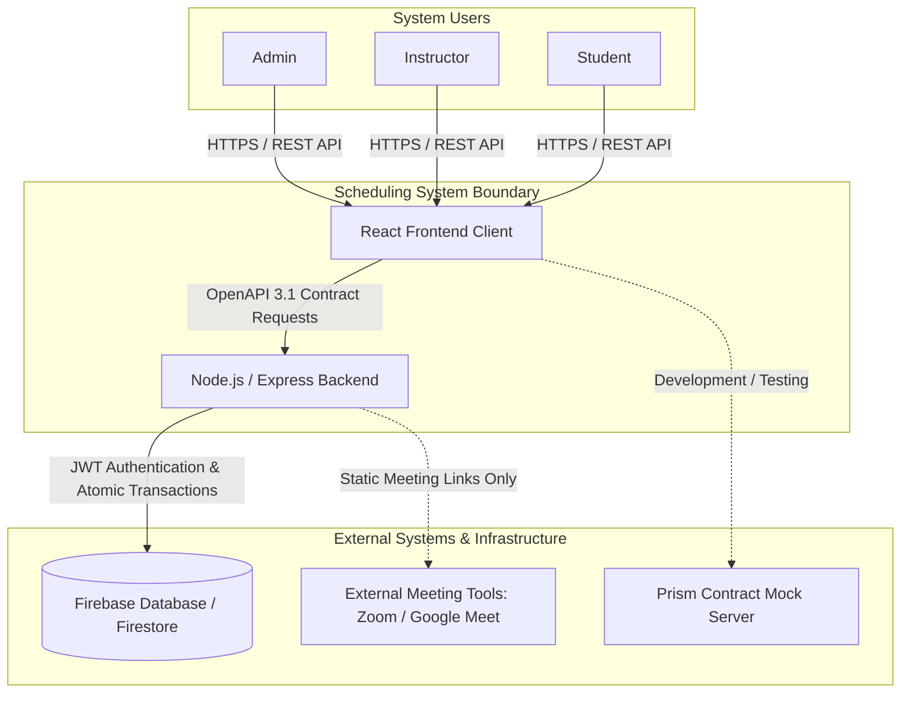

# System Boundary Specification

This document defines the architectural boundary, operational context, external interfaces, in-scope MVP deliverables, and explicit out-of-scope exclusions for the Appointment and Class Scheduling System.

---

## 1. System Context & External Interactions
The scheduling system acts as a centralized application layer interacting with internal users and external infrastructure services.

### Context Diagram

### External System Interactions
- **Database Engine (Firebase / Firestore):** The backend interacts with Firebase for persistent document storage and relies on atomic transactions to prevent race conditions during booking. The frontend **never** connects directly to the database.
- **Contract Mocking Tooling (Prism):** During sprint development, the frontend consumes mock endpoints generated directly from `openapi.yaml` to ensure zero dependency on backend availability.
- **External Video Conferencing (Out of Boundary):** Live lesson environments (Zoom, Google Meet, Microsoft Teams) operate strictly outside system boundaries; the platform only facilitates static link passing without active API integrations.

---

## 2. In-Scope Features (Sprint 1 / MVP)
- **User and Role Management:**
  - Role-based account definitions: `ADMIN`, `INSTRUCTOR`, and `STUDENT`.
  - Admin creation of users with duplicate email checks returning `409 Conflict` (`EMAIL_ALREADY_EXISTS`).
  - Admin-managed student-to-instructor pairings persisted in the database.
- **Calendar and Availability Management:**
  - Forward-looking availability slot creation by instructors.
  - Strict validation disallowing slot creation in the past or with invalid date ranges.
- **Appointment and Reservation Flow:**
  - Student filtering and retrieval of availability slots strictly belonging to their assigned instructor.
  - Atomic booking of available slots returning `201 Created`.
  - Deterministic race condition handling returning `409 Conflict` (`SLOT_UNAVAILABLE`) when a slot is simultaneously booked by another peer.
  - Automatic identity derivation from JWT claims (students cannot spoof caller ID in request bodies).

---

## 3. Out-of-Scope / Deferred Features
The following capabilities are deliberately excluded from the MVP scope to maintain architectural focus and meet semester delivery timelines:
- **Automated Messaging & SMS Gateways:** No direct integration with WhatsApp Business API, Telegram bots, or SMS carriers; notifications remain client-side and HTTP response-based.
- **Payment Processing & Invoicing:** No integration with external payment gateways (Stripe, Iyzico, etc.) or credit balance purchasing mechanisms.
- **Live Video Streaming & Whiteboards:** No proprietary WebRTC or live audio/video streaming infrastructure; external meeting links will be shared statically.
- **File Management & Assignment Submissions:** No cloud bucket storage for homework uploads, lecture notes, or syllabus distribution.

---

## 4. System Constraints & Assumptions

### Constraints
- **Architectural Constraint (API-First):** All client-server communication must strictly conform to `openapi.yaml` (v0.2.1); backend endpoints and client services cannot deviate from the defined schema.
- **Security Constraint:** Except for `POST /auth/login`, all routes require a valid Bearer JWT. User roles must be validated on every backend transaction.
- **Temporal Constraint:** All timestamps must be represented in ISO 8601 UTC format (`YYYY-MM-DDTHH:mm:ssZ`) to prevent timezone inconsistencies across clients.
- **Platform Constraint:** The initial release targets responsive modern web desktop and mobile browsers; native mobile wrappers are not supported.

### Assumptions
- Instructors and students are provisioned by the Admin prior to entering the scheduling workflow.
- Both parties maintain reliable internet connectivity during scheduling actions.
- Each private lesson appointment occupies exactly one contiguous availability slot created by the instructor.